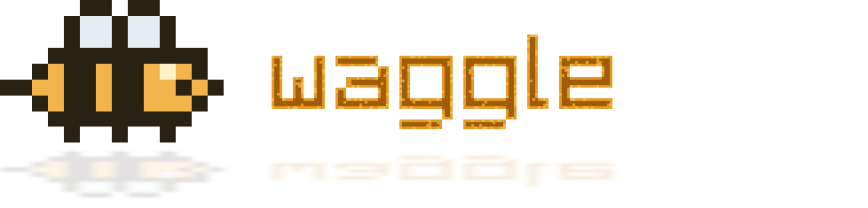
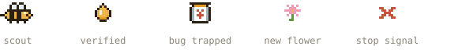

# Waggle

<picture>
  <source media="(prefers-color-scheme: dark)" srcset="assets/waggle-lockup-dark.svg">
  
</picture>

<b>Cheap scouts explore on their own. A quorum decides. Dissent stays on the record.</b>

A cross-family model panel for coding agents. Cheap models from several
families spar first, the sequence climbs to a frontier model, and a
combiner merges what survived. Your agent gets the findings, with file and
line citations, and decides.

Named after the honeybee waggle dance: scouts explore, report back, others
verify, and a quorum decides.

## Status

Pre-release. The first public release is in preparation, together with a
pre-registered benchmark. This repository and the `waggle-ai` packages on
PyPI and npm are reserved for it. Installing them today gives a placeholder
`waggle` command that prints this notice.

## The dance

<picture>
  <source media="(prefers-color-scheme: dark)" srcset="assets/waggle-dance-dark.svg">
  
</picture>

A honeybee scout that found flowers dances a figure eight on the comb. The angle of the straight run says where the flowers are, and its length says how far. Other bees check the site before they back it, and a quorum decides.

<picture>
  <source media="(prefers-color-scheme: dark)" srcset="assets/waggle-icons-dark.svg">
  
</picture>

## License

MIT
